###

<picture data-importer="pacman">
  <source media="(prefers-color-scheme: dark)" srcset="https://raw.githubusercontent.com/Unknown232232/Unknown232232/pacman-output/pacman-contribution-graph-dark.svg?game=pacman">
  <source media="(prefers-color-scheme: light)" srcset="https://raw.githubusercontent.com/Unknown232232/Unknown232232/pacman-output/pacman-contribution-graph.svg?game=pacman">
  
</picture>

# Hallo, ich bin Dennis 👋

**Fachinformatiker für Anwendungsentwicklung (in Umschulung)**  
Frontend · JavaScript · HTML/CSS · Softwareentwicklung

Ich lerne Softwareentwicklung praxisnah und setze die Inhalte der Umschulung direkt in eigenen Projekten um.

---

### 🚀 Aktueller Fokus

- Moderne Frontend-Entwicklung (HTML, CSS, JavaScript)
- Responsive Design & UI-Komponenten
- Git & professioneller Workflow mit GitHub
- Praktische Anwendungsprojekte aus der Umschulung

---

### 🛠️ Tech Stack

  
  
  
  
  
  
  
  
  
  
  
  
  

---

### 📂 Featured Projects

| Projekt | Beschreibung | Tech |
|---------|--------------|------|
| **[BestellAPP](https://github.com/Unknown232232/BestellAPP)** | Responsive Bestell-App für ein Restaurant (Menü, Warenkorb, Bestellablauf) | HTML · CSS · JavaScript |
| **[Fotogram](https://github.com/Unknown232232/Fotogram)** | Foto-Galerie / Image-Viewer mit modernen CSS-Techniken | HTML · CSS · JavaScript |
| **[04_Git_Uebung](https://github.com/Unknown232232/04_Git_Uebung)** | Übungsprojekt zu Git-Workflow und grundlegender Web-Struktur | HTML · CSS · Git |

---

### 🎯 Ziele

- Softwareentwicklung professionell und nachhaltig beherrschen
- Eigene, gut dokumentierte Anwendungen entwickeln
- Moderne Frontend-Technologien sicher einsetzen
- AI und Automatisierung sinnvoll in Projekte integrieren
- Praktische Erfahrung durch kontinuierliche eigene Projekte sammeln

---

### 📈 GitHub-Aktivität

Hier dokumentiere ich meinen Lernfortschritt und die Entwicklung meiner Projekte während der Umschulung zum Fachinformatiker für Anwendungsentwicklung.

---

### Kontakt

